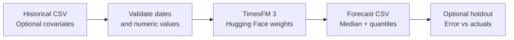

# DKS Time Series Forecasting

A small CSV runner for Google's **TimesFM 3.0**. Download the pretrained model from
Hugging Face, supply historical observations, and save forecasts of average ticket,
transactions, revenue, or other numeric series. No fine-tuning or LLM API is required.

This public repository contains the method and a synthetic-data generator. It includes
**no private DKS data, investment-model numbers, historical research results, or API keys**.

## System design



## Quick start

Use Python 3.11 or later, Git, and enough memory for the model and inference. CPU is
the default; use `--device cuda` with a compatible PyTorch/CUDA installation for a GPU.
The first model run downloads weights to the standard Hugging Face cache. No API key
is normally needed for the public checkpoint.

```bash
python3 -m venv .venv
source .venv/bin/activate
pip install -r requirements.txt
python data/generate_example.py
python forecast.py --input data/example.csv \
  --targets ticket transactions revenue --freq W-MON --horizon 12 \
  --output outputs/example
```

The example is **fictional**, with 104 weekly observations. Its generator is deterministic.
Replace the input with your own authorized data to run research. Use a new output directory
for each run; existing runs are not overwritten.

If the checkpoint download stalls in Hugging Face's Xet transfer client, rerun the command
with `HF_HUB_DISABLE_XET=1` before `python forecast.py` to use standard HTTP downloads.

## Input format

One row per time period, in chronological order, with a `date` column and numeric columns:

```csv
date,ticket,transactions,revenue,traffic,promotion
2024-01-01,75,1000,75000,3500,0
2024-01-08,76,1100,83600,3800,1
```

These two fictional rows illustrate the schema only. The runner requires 32–15,360
training rows. Choose `--freq W-MON` for Mondays, `MS` for month starts, or `D` for daily
observations. Duplicates, missing periods, nonfinite values and misaligned dates fail
validation. The runner does not silently interpolate or resample your data.

For Excel, export **historical observations** to CSV. Exclude workbook projections from
training. Use the same units, time frequency and store coverage throughout each series.
Choose economically related columns for a joint forecast, such as ticket and transactions
for the same banner. Run unrelated markets separately if pooling them is inappropriate.

## Optional covariates

Historical-only covariates, such as observed traffic, end at the forecast cutoff.
Known covariates, such as scheduled promotions, need both historical and future values.
The future CSV must contain exactly the next `--horizon` dates and the selected known
covariate columns. Targets and the two covariate sets must be disjoint.

```bash
python forecast.py --input data/example.csv \
  --targets ticket transactions revenue --past-covariates traffic \
  --known-covariates promotion --future data/future.csv \
  --freq W-MON --horizon 12 --output outputs/with-promotion
```

The generator creates the matching `data/future.csv`. Append `--validate-only` to check
inputs and tensor dimensions without loading the model. Targets have shape
`(number_of_targets, historical_periods)`. Known covariates span history plus the horizon.

## Holdout check

Reserve the final 12 historical periods, forecast from everything before them, and compare
against the withheld observations:

```bash
python forecast.py --input data/example.csv \
  --targets ticket transactions revenue --past-covariates traffic \
  --known-covariates promotion --freq W-MON --horizon 12 --holdout \
  --output outputs/holdout
```

The split excludes future targets and future historical-only covariates from inference.
Only select known covariates that genuinely would have been available at that historical
cutoff. A schedule revised later would introduce leakage. This is a single chronological
holdout, not a rolling backtest or evidence of model accuracy on real DKS data.

## Outputs

- `forecast.csv`: one row per date and target, with a median `forecast` and `p10` through
  `p90` model quantiles. Values retain the input units. The runner does not clip forecasts.
- `manifest.json`: model revision, input hashes, runner hash, columns, cutoff and installed
  package versions. Model code and default weights are pinned to explicit revisions.
- `metrics.json` in holdout mode: MAE, RMSE, WAPE as a fraction, and a last-observation
  baseline MAE per target. WAPE is null when the denominator is zero.

Generated CSVs, model weights and all outputs stay local and are ignored by Git. Hardware
and dependency differences can still affect numerical results; retain the manifest and
input files when reproducing a run.

## How to use this in the DKS analysis

Historical ticket and transactions can inform a baseline revenue path. Forecasting revenue
as a separate target is supported, but the model does not impose the accounting identity
`revenue = average ticket × transactions`. Reconcile those series explicitly before using
them in a financial model. Multiplying median forecasts does not yield expected revenue.

HoS and FastBreak format effects need observed format histories or separately stated
scenario assumptions. Merely labeling a future store as remodeled does not establish a
causal uplift. This runner does not manufacture a remodel premium or derive annual fleet
revenue from isolated shopping sessions. Quantiles are marginal forecasts per date and
series; summing their endpoints does not produce a valid aggregate prediction interval.

## Tests

The offline tests check date validation, future-data alignment, holdout separation and
forecast-to-CSV mapping. They require NumPy and pandas but no downloaded weights.

```bash
python -m unittest discover -s tests -v
```

## Upstream model and license

- [Official TimesFM source and API](https://github.com/google-research/timesfm)
- [Hugging Face checkpoint](https://huggingface.co/google/timesfm-3.0-pytorch)
- [Google's architecture explanation](https://research.google/blog/timesfm-3-a-zero-shot-foundation-model-for-multivariate-forecasting/)

Google distributes the downloaded TimesFM 3 weights under the
[TimesFM Non-Commercial License v1.0](https://huggingface.co/google/timesfm-3.0-pytorch/blob/main/LICENSE).
The upstream source code has a separate Apache-2.0 license. This runner does not change
those terms or bundle the weights. Check the model's terms for your intended use.
